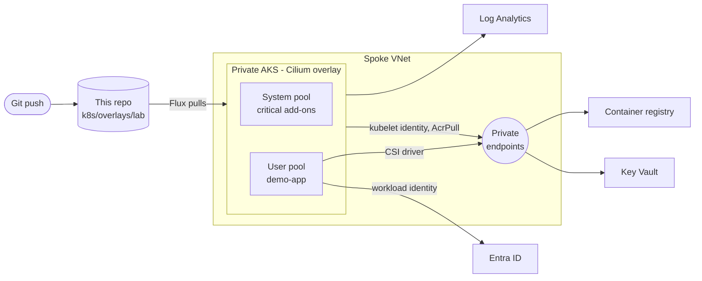

# terraform-azurerm-aks

[](https://github.com/goosain-platform-lab/terraform-azurerm-aks/actions/workflows/ci.yml)

Terraform module for a **private, secretless AKS cluster** with GitOps. It runs standalone ([`examples/standalone`](examples/standalone)) or as a workload in [ai-landing-zone-lab](https://github.com/goosain-platform-lab/ai-landing-zone-lab).

## What this demonstrates

- **Private cluster:** the API server has no public endpoint, and the registry and Key Vault sit behind private endpoints.
- **Identity everywhere, secrets nowhere:**
  - Entra ID sign-in with Azure RBAC for Kubernetes, and local accounts disabled.
  - Nodes pull images with their own identity.
  - Pods reach Key Vault through **workload identity federation** and the Secrets Store CSI driver.
- **Modern networking:** Azure CNI Overlay with the Cilium data plane, and default-deny network policies.
- **GitOps:** Flux (an AKS extension) applies [`k8s/overlays/lab`](k8s/overlays/lab). Terraform hands Flux the environment values (identity client ID, tenant, vault name), so the manifests in Git stay generic.
- **Operations built in:**
  - automatic patch and node-image upgrades inside maintenance windows;
  - a system pool tainted for critical add-ons only;
  - autoscaling user pool across zones;
  - Container Insights, the Azure Policy add-on, image cleaner, and control-plane audit logs.
- **Hardened workload:** Pod Security "restricted", non-root, read-only root filesystem, dropped capabilities, resource limits, probes, a PodDisruptionBudget and zone spread.
- **CI quality gates:**
  - `terraform validate` and tflint;
  - kustomize build piped into kubeconform (strict, against Kubernetes and CRD schemas);
  - Checkov for Terraform and Kubernetes;
  - actions pinned to commit SHAs.

**Status:** validated in CI; not deployed, to avoid running costs.

## Architecture



| Identity | Used by | Permissions |
|---|---|---|
| `id-apps-cp-*` | Control plane | Network Contributor on the node subnet; Managed Identity Operator on the kubelet identity; Private DNS Zone Contributor when the API zone is hub-owned |
| `id-apps-kubelet-*` | Nodes | AcrPull on the registry |
| `id-apps-workload-*` | `demo/demo-app` service account (federated credential) | Key Vault Secrets User on the vault |
| Your admin groups | People | AKS RBAC Cluster Admin + Cluster User |

Names follow `<type>-<workload>-<environment>-<region>` with workload `apps`, for example `aks-apps-lab-zan`, `crappslabzan` and `kv-apps-lab-zan`.

Default sizes are production-grade: Standard tier (uptime SLA), 3-5 system nodes and 2-10 user nodes on `Standard_D4ds_v5` (a "d" size, because ephemeral OS disks need local disk), spread across zones 1-3.

## How the GitOps handoff works

1. Terraform creates the workload identity, the federated credential for `system:serviceaccount:demo:demo-app`, and the Key Vault.
2. The Flux configuration passes `WORKLOAD_CLIENT_ID`, `AZURE_TENANT_ID` and `KEY_VAULT_NAME` as post-build substitutions.
3. Flux renders [`k8s/overlays/lab`](k8s/overlays/lab), replaces the `${...}` placeholders, and applies it.
4. The pod starts with a federated token, and the CSI driver mounts `demo-secret` from Key Vault at `/mnt/secrets`.

## Setup (if you deploy it)

1. Run the one-time [bootstrap script](scripts/bootstrap-azure.ps1) with `-Workspaces ai-aks-lab`. It sets up OIDC, roles and an admin group, with no secrets.
2. Create HCP workspace `ai-aks-lab` with working directory `examples/standalone`, the four environment variables the script prints, and `admin_group_object_ids = ["<group id>"]`.
3. Plan and apply.
4. Add the demo secret. The vault is private, so do this from a VNet-connected machine:
   `az keyvault secret set --vault-name <kv> -n demo-secret --value hello`
5. Reach the private API server from inside the VNet (jumpbox or VNet runner):
   ```powershell
   az aks get-credentials -g rg-aks-lab-zan -n aks-apps-lab-zan
   kubelogin convert-kubeconfig -l azurecli
   kubectl get pods -n demo
   ```

## Cost

AKS Standard tier, at least 5 `D4ds_v5` nodes, a Premium registry and private endpoints all run continuously. For a short session, set `sku_tier = "Free"`, shrink both pools to 1 node, and run `terraform destroy` afterwards.

## Module reference

**Required inputs:** `location`, `resource_group_name`, `node_subnet_id`, `private_endpoint_subnet_id`, `private_dns_zone_ids` (keys `acr`, `vault`), `log_analytics_workspace_id`.

**Optional inputs:**
- Hub integration: `api_server_private_dns_zone_id` (a hub-owned `privatelink.<region>.azmk8s.io` zone) and `outbound_type = "userDefinedRouting"` (egress through a hub firewall).
- GitOps: `gitops_repository_url`, `gitops_branch`, `gitops_path`.

**Outputs:** `cluster`, `registry`, `key_vault`, `workload_identity`.
